# Salud Digna Omnicanal — Un paciente, una sola conversación

Prototipo para el track **"Orquestación Omnicanal de Atención"** de **Salud Digna × TecNM HackaTec** (InnovaTecNM 2026).

El paciente puede iniciar un trámite en la **web**, continuarlo por **WhatsApp**, resolver una duda con el **Call Center** y ver su cita confirmada en la **app**, sin repetir datos ni empezar de cero.



## Los cuatro pilares

| Pilar | Cómo lo resolvemos |
| --- | --- |
| **Identidad** | Un paciente, muchas identidades de canal (teléfono, email, app), vinculadas solo tras verificar con OTP |
| **Contexto y estado** | Máquina de estados del trámite y contexto autoguardado en cada paso |
| **Trazabilidad** | Catálogo de eventos, línea de tiempo unificada y bitácora de auditoría |
| **Seguridad** | JWT + roles, OTP, cifrado de datos sensibles, enmascarado y cumplimiento de la LFPDPPP |

## Estructura del repositorio

```text
SaludDignaSWIHackaTec/
├── apps/
│   ├── api/            Núcleo API (NestJS + Prisma): identidad, trámites, contexto, eventos, tickets, IA
│   ├── whatsapp-bot/   Webhook de WhatsApp Cloud API y diálogo
│   ├── web/            Portal paciente, consola asesor, vista médica, Patient Journey y KPIs
│   └── mobile/         App móvil Expo (Android/iOS)
├── packages/
│   ├── shared/         Contrato común: enumeraciones y catálogo de eventos (zod)
│   ├── ui/             Tokens visuales, metadatos por canal y contrato del Timeline
│   └── config/         Configuración compartida de TypeScript y ESLint
├── infra/              Docker Compose (dev/prod) y Nginx
├── docs/               Arquitectura, ADRs, modelo de datos y catálogo de eventos
└── .github/            Workflows de CI, plantillas de issues y PR
```

## Inicio rápido (desarrollo local)

Requisitos: **Node.js >= 22**, **npm >= 10** y **Docker** (para MySQL 8 y Redis 7).

```bash
# 1. Instalar dependencias del monorepo
npm install

# 2. Levantar MySQL 8 (utf8mb4) y Redis 7
docker compose -f infra/docker-compose.dev.yml up -d

# 3. Copiar variables de entorno de ejemplo (nunca subir .env reales)
cp apps/api/.env.example apps/api/.env
cp apps/whatsapp-bot/.env.example apps/whatsapp-bot/.env
cp apps/web/.env.example apps/web/.env

# 4. Aplicar migración inicial y generar cliente Prisma
npm run prisma:migrate:dev
npm run prisma:generate

# 5. Levantar api (3000), whatsapp-bot (3001) y web (3002) en paralelo
npm run dev
```

### Scripts principales desde la raíz

| Comando | Descripción |
| --- | --- |
| `npm run dev` | Levanta `api`, `whatsapp-bot` y `web` en paralelo |
| `npm run lint` | Ejecuta ESLint en todo el monorepo |
| `npm run format:check` | Verifica formato Prettier en todo el repositorio |
| `npm run typecheck` | Valida tipos TypeScript en todos los workspaces |
| `npm test` | Ejecuta pruebas unitarias en todos los workspaces |
| `npm run build` | Compila paquetes compartidos y todas las apps |
| `npm run docs:eventos` | Regenera `docs/eventos.md` desde los esquemas Zod |

## Documentación

- [Arquitectura de la solución](docs/arquitectura/README.md) · [ADRs](docs/arquitectura/adr/README.md)
- [Modelo de datos (MySQL 8 + Prisma)](docs/modelo-datos/README.md)
- [Catálogo de eventos omnicanal](docs/eventos.md)
- [Cómo trabajamos](CONTRIBUTING.md) · [Guía para agentes y desarrollo](AGENTS.md)

## Tablero

Las tareas están en **SaludDignaKanban**: <https://github.com/users/KevinDCCsHeOs/projects/4> (issues `01.` a `42.`).

## Credenciales de prueba y guion del demo

Se documentarán en los issues #17 y #40.
