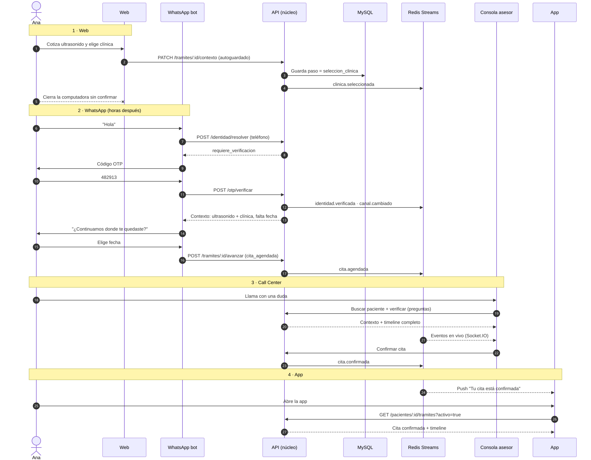

# Arquitectura de la solución

> Issue: **01. [ARQ] Arquitectura de la solución** (#1) · Estado: propuesta v1 · Fecha: 2026-11-24
>
> Fuentes editables de los diagramas: [`diagramas/*.mmd`](diagramas/) (Mermaid). Exportados en SVG y PNG en la misma carpeta.

## Índice

1. [Propósito y alcance](#1-propósito-y-alcance)
2. [Qué guía la arquitectura](#2-qué-guía-la-arquitectura)
3. [Vista de contexto (C4 nivel 1)](#3-vista-de-contexto-c4-nivel-1)
4. [Vista de contenedores (C4 nivel 2)](#4-vista-de-contenedores-c4-nivel-2)
5. [Módulos del API (C4 nivel 3)](#5-módulos-del-api-c4-nivel-3)
6. [Comunicación entre componentes](#6-comunicación-entre-componentes)
7. [Cómo se resuelven los cuatro pilares](#7-cómo-se-resuelven-los-cuatro-pilares)
8. [Recorrido de Ana de punta a punta](#8-recorrido-de-ana-de-punta-a-punta)
9. [Vista de despliegue](#9-vista-de-despliegue)
10. [Seguridad por capas](#10-seguridad-por-capas)
11. [Resiliencia y escalabilidad](#11-resiliencia-y-escalabilidad)
12. [Decisiones de arquitectura (ADR)](#12-decisiones-de-arquitectura-adr)
13. [Riesgos técnicos](#13-riesgos-técnicos)
14. [Responsabilidades por frente y siguientes pasos](#14-responsabilidades-por-frente-y-siguientes-pasos)

---

## 1. Propósito y alcance

Este documento describe cómo se conectan los canales de atención (Web, App, WhatsApp y Call Center), el motor de contexto, el bus de eventos y la base de datos del prototipo para el track **"Orquestación Omnicanal de Atención: Un paciente, una sola conversación"** (Salud Digna × TecNM HackaTec).

Es la referencia para todo el equipo: cada frente construye su parte respetando los contratos aquí definidos. Cubre el entregable **"Arquitectura de solución"** del reto; el detalle de secuencias y del modelo de datos se amplía en los issues #41 y #2.

**Alcance del prototipo:** demostrar en vivo la continuidad de un trámite (cotización → cita confirmada) a través de al menos tres canales, con identidad unificada, estado persistente, trazabilidad completa y protección de datos. No se integra con sistemas internos reales de Salud Digna: catálogos y pacientes son ficticios.

## 2. Qué guía la arquitectura

### Requisitos del reto

| Requisito | Implicación en la arquitectura |
| --- | --- |
| Continuidad entre ≥ 3 canales | Un **único API** como fuente de verdad; los canales son clientes "delgados" que no guardan estado propio del trámite |
| Recordar en qué paso se quedó | **Máquina de estados** del trámite + **contexto** autoguardado en cada paso |
| Línea de tiempo unificada | **Eventos** con canal, actor y hora para todo cambio de estado |
| Vista en tiempo real del *Patient Journey* | **Bus de eventos** + **WebSockets** hacia los tableros |
| Vistas por rol (paciente, asesor, admin) | **RBAC** en el API; el frontend solo decide qué mostrar |
| Resiliencia ante interrupciones e información parcial | Persistencia inmediata, idempotencia y colas para mensajes entrantes |
| Seguridad y privacidad | Verificación antes de revelar, cifrado de campos sensibles, auditoría |

### Atributos de calidad priorizados

1. **Consistencia del contexto**: el mismo trámite se ve igual en todos los canales (fuente única en MySQL).
2. **Seguridad y privacidad**: datos de salud = datos sensibles (LFPDPPP).
3. **Estabilidad del demo**: el sistema debe funcionar en vivo ante el jurado; se prefiere tecnología conocida y pocas piezas móviles.
4. **Latencia percibida**: un cambio en un canal aparece en los demás en menos de 2 segundos.
5. **Evolución**: módulos con límites claros para separarlos en servicios después si hiciera falta.

### Restricciones

- Tiempo de hackathon y equipo pequeño → **monolito modular** en lugar de microservicios.
- Una sola VPS (Hostinger KVM 2: 2 vCPU, 8 GB RAM) → todo en **Docker Compose**.
- WhatsApp solo vía **WhatsApp Business Platform (Cloud API)**; la app de WhatsApp Business del celular no tiene API.

## 3. Vista de contexto (C4 nivel 1)



| Actor / sistema | Relación con la plataforma |
| --- | --- |
| Paciente | Usa la web, la app y WhatsApp; puede llamar al Call Center |
| Asesor / asesor pro | Atiende con la consola, viendo el contexto previo del paciente |
| Médico y revisor técnico | Revisan, validan y liberan resultados |
| Administrador | Monitorea el *Patient Journey*, KPIs, tickets por región y auditoría |
| Meta WhatsApp Cloud API | Entrega los mensajes del paciente por webhook y envía las respuestas y plantillas |
| Proveedor de LLM | Clasifica la intención y redacta respuestas; recibe solo el contexto mínimo necesario |
| Expo Push / correo / SMS | Notificaciones y códigos OTP |

## 4. Vista de contenedores (C4 nivel 2)



| Contenedor | Tecnología | Responsabilidad | Issues |
| --- | --- | --- | --- |
| `apps/api` | NestJS (Node 22, TypeScript) | Núcleo: identidad, OTP, trámites, contexto, eventos, timeline, tickets, resultados, auditoría, IA y gateway de tiempo real | #6–#17, #24, #25, #30, #31 |
| `apps/whatsapp-bot` | NestJS | Recibe el webhook de Meta, responde `200` al instante, encola, mantiene la sesión de diálogo y llama al API | #20, #21 |
| `apps/web` | Next.js | Portal del paciente, consola del asesor, vista médica, *Patient Journey* y KPIs | #18, #19, #27–#30 |
| `apps/mobile` | Expo / React Native | App del paciente (Android/iOS) con notificaciones push | #22 |
| `packages/shared` | TypeScript + zod | Contrato común: tipos, enums, catálogo de eventos y validaciones | #3 |
| MySQL 8 | Prisma ORM | Fuente de verdad: pacientes, identidades, trámites, eventos, tickets, auditoría | #2 |
| Redis 7 | Streams, claves con TTL | Distribución de eventos, caché de contexto, OTP, sesiones de conversación de WhatsApp | #8, #13, #14 |

**Regla de oro:** ningún canal accede a MySQL o Redis del núcleo directamente; todo pasa por `apps/api`. El bot solo usa Redis para su propia sesión de diálogo (`wa:sesion:*`).

## 5. Módulos del API (C4 nivel 3)

El API es un **monolito modular**: un solo despliegue con módulos de NestJS que solo se comunican por sus servicios públicos y por eventos.



| Capa | Módulo | Responsabilidad |
| --- | --- | --- |
| Transversal | `auth` | Login, JWT (access 15 min / refresh 7 días), guards por rol y permiso |
| Transversal | `privacidad` | Cifrado AES-256-GCM de campos sensibles, enmascarado por rol, consentimiento |
| Transversal | `auditoria` | Interceptor global: quién leyó o modificó qué dato, desde qué canal |
| Dominio | `identidad` | Normaliza identificadores, resuelve y vincula identidades de canal al paciente |
| Dominio | `otp` | Genera y verifica códigos (hash en Redis, TTL 5 min, 3 intentos) |
| Dominio | `tramites` | Máquina de estados del trámite y folio legible (`SD-2026-000123`) |
| Dominio | `contexto` | Autoguardado de datos parciales, resumen en lenguaje natural para bot y asesor |
| Dominio | `tickets` | Tipos, prioridad, SLA, región, escalamiento IA → asesor → asesor pro |
| Dominio | `resultados` | Captura → revisión técnica → validación médica → liberación |
| Dominio | `catalogos` | Estudios, precios, preparación, clínicas y su estatus |
| Dominio | `ia` | Clasificación de intención, extracción de entidades, guardrails |
| Eventos | `eventos` | `EventBus`: guarda el evento en la misma transacción y lo publica en Redis Streams |
| Consumidores | `timeline`, `realtime`, `notificaciones`, `metricas` | Construyen la línea de tiempo, empujan cambios por Socket.IO, envían avisos y calculan KPIs |

Estructura de carpetas esperada:

```text
apps/api/src/
├── auth/  privacidad/  auditoria/
├── identidad/  otp/  tramites/  contexto/  tickets/  resultados/  catalogos/  ia/
├── eventos/  timeline/  realtime/  notificaciones/  metricas/
└── main.ts · app.module.ts
```

## 6. Comunicación entre componentes

| Tipo | Uso | Tecnología | Regla |
| --- | --- | --- | --- |
| **Comandos y consultas** | Canal → API (crear trámite, avanzar, consultar contexto) | REST/JSON sobre HTTPS | Validación con zod (`packages/shared`); JWT de usuario o token de servicio para el bot |
| **Eventos de dominio** | API → consumidores internos | Redis Streams (`XADD` / `XREADGROUP`) | Todo cambio de estado publica un evento del catálogo; consumidores idempotentes por `eventId` |
| **Tiempo real** | API → web, consola, tableros y app | Socket.IO (WSS) | Salas `paciente:{id}`, `rol:asesor`, `rol:admin`; el socket se autentica con el mismo JWT |
| **Mensajería externa** | Meta ↔ bot | Webhook HTTPS + Graph API | Verificar firma `X-Hub-Signature-256`; responder `200` y procesar en cola; deduplicar por `message.id` |
| **Notificaciones** | API → paciente | Plantillas de WhatsApp, Expo Push, correo | Siempre por el canal preferido del paciente y con su consentimiento |



**Consistencia entre MySQL y Redis (patrón *outbox*):** el cambio de estado y la fila en la tabla `Evento` se guardan en **una sola transacción**. Después, el `EventBus` publica en Redis Streams. Si Redis falla, un proceso de reintento lee los eventos no publicados de `Evento` y los reenvía. Así nunca hay un cambio de estado sin evento ni un evento sin cambio.

## 7. Cómo se resuelven los cuatro pilares

| Pilar | Mecanismo | Componentes | Evidencia en el demo |
| --- | --- | --- | --- |
| **1 · Identidad** | Tabla `IdentidadCanal` que vincula teléfono, email, usuario de app o CURP a un único `Paciente`; resolución por identificador normalizado; vinculación solo tras verificación | `identidad`, `otp` | WhatsApp reconoce a Ana por su teléfono y, tras el OTP, le muestra su trámite web |
| **2 · Contexto y estado** | Máquina de estados del trámite + objeto `contexto` (estudio, clínica, fecha, pendientes, último canal) autoguardado en cada paso; caché en Redis, verdad en MySQL | `tramites`, `contexto` | Ana retoma en WhatsApp exactamente en "falta elegir fecha" |
| **3 · Trazabilidad** | Catálogo de eventos versionado; cada evento con `canal`, `actor`, `timestamp`; timeline unificado; bitácora de auditoría de solo inserción | `eventos`, `timeline`, `auditoria` | El asesor y el admin ven Web → WhatsApp → Call Center → App en orden |
| **4 · Seguridad** | JWT + RBAC; OTP antes de revelar; cifrado de campos sensibles; enmascarado por rol; consentimiento registrado; TLS; secretos fuera del repo | `auth`, `otp`, `privacidad`, `auditoria`, Nginx | Sin OTP el bot no muestra nada; la consola enmascara CURP |

## 8. Recorrido de Ana de punta a punta



Puntos clave que la arquitectura garantiza en este recorrido:

- **Paso 2**: el avance se guarda **antes** de confirmar; cerrar el navegador no pierde nada.
- **Pasos 7–13**: el bot no revela el trámite hasta verificar la identidad; después recibe un contexto ya resumido.
- **Paso 21**: la consola del asesor se actualiza sola por Socket.IO cuando Ana avanza en WhatsApp.
- **Paso 24**: la confirmación llega a la app por push sin que Ana tenga que buscarla.

El detalle de cada intercambio (payloads, errores, reintentos) se documenta en #41.

## 9. Vista de despliegue



| Servicio | Puerto interno | Expuesto | Dominio | Notas |
| --- | --- | --- | --- | --- |
| `nginx` | 80 / 443 | ✅ | — | TLS con Let's Encrypt, `Upgrade` para WebSocket, límites de tamaño y tasa |
| `web` | 3002 | vía nginx | `app.<dominio>` | Next.js en modo `standalone` |
| `api` | 3000 | vía nginx | `api.<dominio>` | REST + Socket.IO |
| `whatsapp-bot` | 3001 | vía nginx | `wa.<dominio>/webhook` | Único punto que recibe tráfico de Meta |
| `mysql` | 3306 | ❌ | — | Volumen persistente, usuario de app sin `DROP` ni `UPDATE/DELETE` sobre `Auditoria` |
| `redis` | 6379 | ❌ | — | AOF activado para no perder streams ni sesiones al reiniciar |
| `backup` | — | ❌ | — | `mysqldump` diario + copia externa (almacenamiento del cPanel) |

- **Presupuesto de memoria aproximado (8 GB):** MySQL 1.5 GB · Redis 256 MB · api 512 MB · bot 256 MB · web 512 MB · nginx 64 MB → ~3 GB en uso, con margen para builds y picos.
- **Entrega continua:** al fusionar a `main`, GitHub Actions entra por SSH, hace `git pull` y `docker compose up -d --build` (#35).
- **Firewall:** solo 22 (SSH con llave), 80 y 443.

## 10. Seguridad por capas

| Capa | Control |
| --- | --- |
| Red | UFW; solo Nginx expuesto; MySQL y Redis en red interna de Docker |
| Transporte | HTTPS/WSS obligatorio; HSTS |
| Entrada | Validación zod de todo payload; rate limit en login, OTP y webhook; verificación de firma de Meta |
| Identidad | JWT de corta duración; refresh en cookie `httpOnly` (web) o SecureStore (app); OTP antes de revelar datos |
| Autorización | RBAC por rol y por recurso (un paciente solo ve lo suyo; el médico solo sus asignados) |
| Datos | Cifrado AES-256-GCM de CURP, fecha de nacimiento, resultados y datos fiscales; enmascarado según rol |
| Trazabilidad | Auditoría de lecturas y escrituras de datos de paciente; eventos inmutables |
| Secretos | Variables de entorno en el servidor (`.env` con permisos 600); solo `.env.example` en el repo |
| IA | Minimización: el LLM recibe un resumen sin identificadores directos; nunca diagnostica |
| Privacidad | Aviso de privacidad, consentimiento por canal, logs sin datos personales |

## 11. Resiliencia y escalabilidad

**Resiliencia (lo que evalúa la final):**

- Interrupción del paciente → el contexto ya está guardado; al volver por cualquier canal se ofrece retomar.
- Reinicio de un contenedor → MySQL es la verdad, Redis con AOF; Docker reinicia (`restart: unless-stopped`).
- Mensajes duplicados o fuera de orden de WhatsApp → deduplicación por `message.id` y transiciones validadas por la máquina de estados.
- Información parcial → registro ligero del paciente y pasos con datos opcionales; el sistema pide solo lo que falta.
- Falla del LLM → el bot cae a un menú con botones; el flujo nunca depende solo de la IA.
- Falla de Redis → los eventos quedan en la tabla `Evento` y se republican (outbox).

**Escalabilidad (cómo crecería):**

1. Varias réplicas de `api` detrás de Nginx con el adaptador de Redis para Socket.IO.
2. Consumidores de eventos en procesos separados del API.
3. Réplicas de lectura de MySQL para timeline y KPIs.
4. Separar `identidad`, `tramites` y `notificaciones` en servicios cuando el volumen lo justifique; los límites de módulo ya lo permiten.

Las pruebas de carga que lo respaldan se hacen en #37.

## 12. Decisiones de arquitectura (ADR)

| ADR | Decisión |
| --- | --- |
| [0001](adr/0001-monolito-modular-y-monorepo.md) | Monolito modular en NestJS dentro de un monorepo TypeScript |
| [0002](adr/0002-mysql-prisma-fuente-de-verdad.md) | MySQL 8 + Prisma como fuente de verdad |
| [0003](adr/0003-eventos-redis-streams-outbox.md) | Eventos con Redis Streams y patrón outbox |
| [0004](adr/0004-tiempo-real-socketio.md) | Tiempo real con Socket.IO |
| [0005](adr/0005-whatsapp-cloud-api-servicio-separado.md) | WhatsApp Cloud API en un servicio separado |
| [0006](adr/0006-identidad-unificada-con-otp.md) | Identidad unificada por identificadores normalizados + OTP |
| [0007](adr/0007-app-movil-expo.md) | App móvil con Expo / React Native |
| [0008](adr/0008-despliegue-vps-docker-compose.md) | Despliegue en VPS con Docker Compose y Nginx |
| [0009](adr/0009-ia-llm-con-guardrails.md) | Asistente con LLM vía API, guardrails y minimización de datos |

## 13. Riesgos técnicos

| Riesgo | Prob. | Impacto | Mitigación | Issue |
| --- | --- | --- | --- | --- |
| Meta tarda en aprobar plantillas o en verificar el número | Media | Alto | Usar el número de prueba de Meta; subir plantillas el día 1; plan B con mensajes dentro de la ventana de 24 h | #20 |
| Falla de red o del servidor durante el demo | Media | Alto | Hotspot propio, datos semilla, `demo:reset`, video de respaldo | #39, #42 |
| Suplantación de identidad por WhatsApp | Media | Alto | OTP obligatorio antes de revelar; bloqueo tras 3 intentos | #8 |
| Duplicidad de pacientes entre canales | Media | Medio | Normalización de identificadores; vincular solo tras verificación; caso "ambiguo" va al asesor | #7 |
| El LLM responde algo incorrecto o clínico | Media | Alto | Guardrails, salida estructurada, umbral de confianza y menú de respaldo | #24 |
| Conflictos entre ramas por el contrato compartido | Alta | Medio | Cambios a `packages/shared` y `schema.prisma` en PR propio y con aviso | #4 |
| Memoria insuficiente al compilar en la VPS | Baja | Medio | Swap de 2 GB; compilar imágenes en CI si hace falta | #35 |

## 14. Responsabilidades por frente y siguientes pasos

| Frente | Carpeta | Primeros issues |
| --- | --- | --- |
| 1 · Núcleo | `apps/api` | #2 Modelo de datos · #3 Catálogo de eventos · #6 Auth · #7 Identidad · #12 Trámites · #13 Contexto · #14 Eventos |
| 2 · WhatsApp e IA | `apps/whatsapp-bot`, `apps/api/src/ia` | #20 Cloud API (iniciar trámite con Meta ya) · #21 Flujo conversacional · #24 Asistente |
| 3 · Web | `apps/web` | #18 Portal · #19 Consola · #27 Patient Journey |
| 4 · App | `apps/mobile` | #22 App Expo |
| 5 · Infra y docs | `infra/`, `.github/`, `docs/` | #4 Monorepo · #35 VPS · #5 CI · #41 Secuencias |

**Orden recomendado:** #2 y #3 (contratos) → #4 (monorepo) → #35 (VPS con HTTPS, requisito del webhook) → núcleo (#6, #7, #8, #12, #13, #14) → canales en paralelo.
