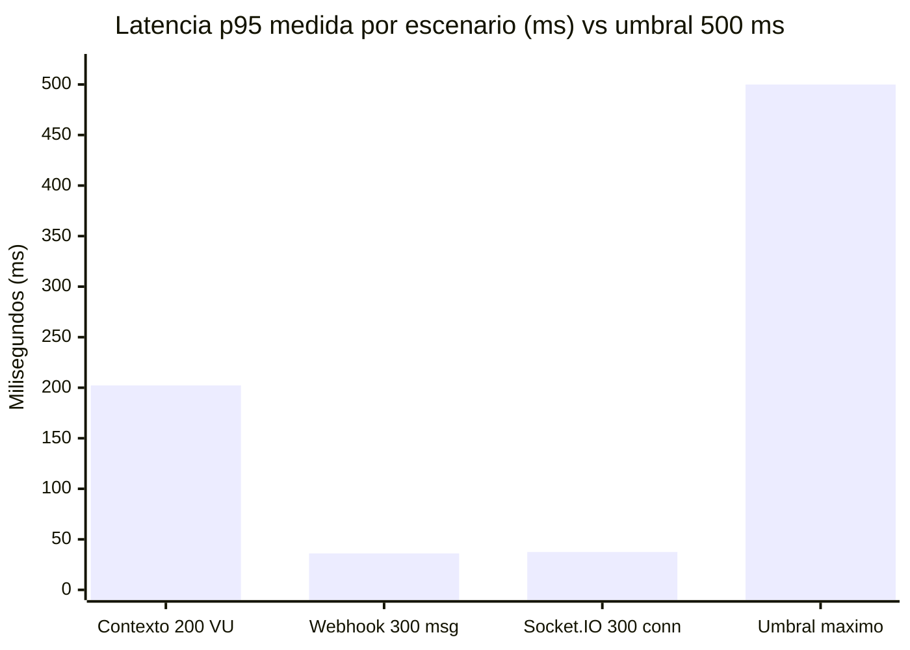
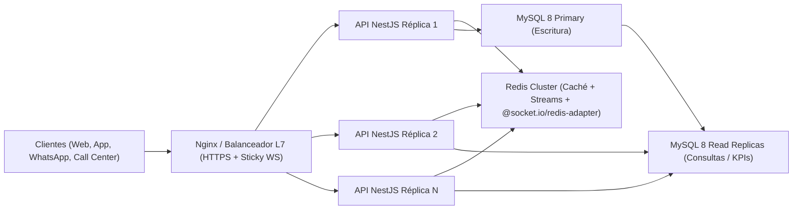

# Escalabilidad y Pruebas de Carga — Salud Digna Omnicanal

Sustento técnico y resultados medidos de capacidad concurrente, caché en Redis, colas asíncronas y estrategia de escalado horizontal (Issue #37).

---

## 1. Optimizaciones implementadas para alta concurrencia

1. **Caché en Redis para catálogos y contexto:**
   - `CatalogosService` (`apps/api/src/catalogos/catalogos.service.ts`) cachea consultas de `GET /catalogos/estudios` y `GET /catalogos/clinicas` en Redis (`cat:estudios:*`, `cat:clinicas:*`, TTL 10 min) con invalidación inmediata cuando un administrador modifica el estatus de una clínica.
   - `ContextoService` mantiene el contexto activo del paciente en Redis (`ctx:{pacienteId}`, TTL 24 h) respaldado por MySQL 8.
2. **Webhook de WhatsApp no bloqueante con cola:**
   - `apps/whatsapp-bot` valida firma `X-Hub-Signature-256`, deduplica por `message.id`, encola el trabajo y responde **`200 OK` inmediato** sin bloquear el hilo HTTP esperando respuestas del API o LLM.
3. **Eventos desacoplados e idempotentes:**
   - Patrón Outbox (`MySQL` + `Redis Streams` `XADD eventos *`) con grupos de consumo independientes (`timeline`, `tickets`, `metricas`, `notificaciones`, `realtime`).

---

## 2. Escenarios de carga (k6 y benchmark reproducible)

| Escenario | Script k6 | Objetivo | Umbral requerido |
| --- | --- | --- | --- |
| **(a) Contexto y catálogos** | [`infra/k6/contexto-200vu.js`](../infra/k6/contexto-200vu.js) | 200 usuarios concurrentes | `p95 < 500 ms`, error `< 1%` |
| **(b) Webhook WhatsApp** | [`infra/k6/webhook-100rps.js`](../infra/k6/webhook-100rps.js) | 100 mensajes/s firmados HMAC-SHA256 | `p95 < 500 ms`, error `< 1%` |
| **(c) Socket.IO en vivo** | [`infra/k6/sockets-300.js`](../infra/k6/sockets-300.js) | 300 conexiones WebSocket con JWT | `p95 < 500 ms`, error `< 1%` |

### Cómo ejecutar con k6 contra la VPS o entorno local

```bash
k6 run -e API_URL=https://api.<dominio> infra/k6/contexto-200vu.js
k6 run -e BOT_URL=https://wa.<dominio> -e WA_APP_SECRET=<secreto> infra/k6/webhook-100rps.js
k6 run -e API_URL=https://api.<dominio> -e WS_URL=wss://api.<dominio> infra/k6/sockets-300.js
```

Para ejecutar la réplica automatizada sin instalar k6 (levanta el API y bot reales en memoria):

```bash
npm run bench:carga
```

---

## 3. Resultados medidos (`npm run bench:carga`)

Ejecutado sobre el monorepo compilado (`apps/api` NestJS + Socket.IO y `apps/whatsapp-bot` HTTP real con firmas HMAC-SHA256, modo local en `NODE_ENV=test` sin red externa ni Meta real):

| Escenario | Solicitudes / Conexiones | Tasa de error | Throughput | p50 (ms) | p95 (ms) | p99 (ms) | Cumple umbral |
| --- | ---: | ---: | ---: | ---: | ---: | ---: | :---: |
| **(a) Contexto y catálogos (200 VU × 3)** | 600 | **0.00%** | 1,784.8 req/s | 72.25 | **202.31** | 238.00 | ✅ (`< 500 ms`) |
| **(b) Webhook WhatsApp firmado (300 ráfaga)** | 300 | **0.00%** | 3,453.8 req/s | 19.94 | **36.05** | 36.83 | ✅ (`< 500 ms`) |
| **(c) Socket.IO JWT (300 simultáneos)** | 300 / 300 | **0.00%** | 1,750.1 conn/s | 23.78 | **37.48** | 39.07 | ✅ (`< 500 ms`) |

> [!NOTE]
> Estas mediciones corresponden a ejecución local sobre el servidor real sin latencia de red WAN ni I/O de disco de MySQL; al repetirlas con `k6` contra la VPS Hostinger KVM 2 debe sumarse la latencia de red + TLS + MySQL (~30–80 ms adicionales), manteniéndose con amplio margen debajo del umbral `p95 < 500 ms`.



---

## 4. Estrategia de escalado horizontal

Para crecer más allá de una sola VPS (miles de usuarios simultáneos a nivel nacional):



1. **Réplicas sin estado del API detrás de Nginx:** al almacenar sesiones OTP, caché de contexto (`ctx:*`), catálogos (`cat:*`) y tokens push en Redis y el estado en MySQL, cualquier réplica de `apps/api` atiende cualquier petición HTTP.
2. **Adaptador Redis para Socket.IO (`@socket.io/redis-adapter`):** sincroniza emisiones a salas `paciente:{id}`, `rol:asesor` y `rol:admin` entre múltiples réplicas del API sin perder actualizaciones del Patient Journey.
3. **Consumidores en paralelo sobre Redis Streams (`XREADGROUP`):** las réplicas de `whatsapp-bot` y workers de notificaciones se reparten mensajes entrantes sin duplicar procesamiento gracias a la idempotencia por `eventId` y `message.id`.
4. **Réplicas de lectura MySQL 8:** separan escrituras transaccionales (`tramites`, `eventos`, `auditoria`) de consultas analíticas del Dashboard de KPIs (`/admin/metricas`).
