# Modelo de datos (MySQL 8 + Prisma)

> Issue: **02. [ARQ] Modelo de datos (MySQL)** (#2) · Estado: v1 · Fecha: 2026-11-24
>
> Contrato compartido: [`apps/api/prisma/schema.prisma`](../../apps/api/prisma/schema.prisma) · Migración inicial: [`apps/api/prisma/migrations/`](../../apps/api/prisma/migrations/) · Enumeraciones compartidas: [`packages/shared/src/enums/`](../../packages/shared/src/enums/)

## Índice

1. [Propósito y principios de diseño](#1-propósito-y-principios-de-diseño)
2. [Diagrama Entidad-Relación (ER)](#2-diagrama-entidad-relación-er)
3. [Catálogo de tablas y propósito](#3-catálogo-de-tablas-y-propósito)
4. [Campos sensibles y privacidad (LFPDPPP)](#4-campos-sensibles-y-privacidad-lfpdppp)
5. [Estrategia de índices y rendimiento](#5-estrategia-de-índices-y-rendimiento)
6. [Catálogo de enumeraciones compartidas](#6-catálogo-de-enumeraciones-compartidas)
7. [Cobertura del recorrido de Ana (cotización → cita → resultados)](#7-cobertura-del-recorrido-de-ana-cotización--cita--resultados)
8. [Decisiones técnicas clave](#8-decisiones-técnicas-clave)
9. [Comandos de Prisma y verificación](#9-comandos-de-prisma-y-verificación)

---

## 1. Propósito y principios de diseño

Este modelo relacional es la **fuente única de verdad** del prototipo omnicanal de Salud Digna (ADR 0002). Solo `apps/api` accede a MySQL; ningún canal (`web`, `mobile`, `whatsapp-bot`) se conecta directo a la base de datos.

Principios que rigen el esquema:

- **Separación de identidad y canal (Pilar 1):** un `Paciente` puede operar desde múltiples `IdentidadCanal` (teléfono de WhatsApp, correo electrónico, usuario de web/app, Call Center). Ninguna identidad se vincula ni expone contexto sin verificación (`verificado_en IS NOT NULL`).
- **Contexto persistente y paso real (Pilar 2):** `Tramite` guarda el estado de la máquina de estados (#12), el paso actual y un objeto `contexto` en `JSON` autoguardado en cada interacción (#13), complementado por `PasoTramite` para medir tiempos y reanudar tras interrupciones.
- **Trazabilidad y patrón outbox (Pilar 3):** todo cambio de estado escribe en `Evento` (UUID v4 idempotente) dentro de la misma transacción MySQL antes de publicarse a Redis Streams (ADR 0003). `Auditoria` es una tabla de solo inserción (`append-only`).
- **Privacidad por diseño — LFPDPPP (Pilar 4):** los campos sensibles se cifran en reposo con AES-256-GCM desde el módulo `privacidad` (#10), el consentimiento queda registrado en `Consentimiento`, y todo registro de prueba se marca con `es_demo = true`.
- **Soporte Unicode completo:** motor MySQL 8 con `utf8mb4` y `utf8mb4_unicode_ci` para soportar acentos, náhuatl y emojis provenientes de WhatsApp.

---

## 2. Diagrama Entidad-Relación (ER)

Fuentes editables Mermaid en [`diagramas/er-modelo-datos.mmd`](diagramas/er-modelo-datos.mmd) (exportado a SVG/PNG).



---

## 3. Catálogo de tablas y propósito

El modelo consta de **15 tablas** agrupadas en cuatro bloques funcionales:

### 3.1 Identidad, acceso y privacidad

| Tabla SQL | Modelo Prisma | Propósito | Relaciones principales |
| --- | --- | --- | --- |
| `roles` | `Rol` | Catálogo RBAC de los 7 roles del sistema (`paciente`, `asesor_ia`, `asesor`, `asesor_pro`, `medico`, `revisor_tecnico`, `admin`) con su matriz de permisos en `JSON` (#6, #29). | `1:N` con `usuarios` |
| `usuarios` | `Usuario` | Cuentas autenticables con correo único, hash bcrypt/argon2 (`hash`), rol con llave foránea a `roles.clave`, región y bandera de actividad. | `N:1` con `roles`; `1:0..1` con `pacientes`; `1:N` con `tickets`, `resultados` (revisor/médico) y `auditoria` |
| `pacientes` | `Paciente` | Registro maestro de la persona atendida, separado de los identificadores por canal. Almacena datos de contacto normalizados, idioma (`es`/`en`/`nah`), canal preferido, región y campos sensibles cifrados. | `1:N` con `identidades_canal`, `consentimientos`, `tramites`, `interacciones`, `eventos`, `tickets` |
| `identidades_canal` | `IdentidadCanal` | Vincula un identificador normalizado (`canal`, `identificador` único) a un `Paciente`. El campo `verificado_en` controla la regla *verificar antes de revelar* (#7, #8). | `N:1` con `pacientes` |
| `consentimientos` | `Consentimiento` | Evidencia auditable del consentimiento expreso (LFPDPPP) por paciente, tipo (`aviso_privacidad`, `datos_sensibles`, `notificaciones`), versión de aviso, canal y posible revocación ARCO (#10). | `N:1` con `pacientes` |

### 3.2 Catálogos operativos

| Tabla SQL | Modelo Prisma | Propósito | Relaciones principales |
| --- | --- | --- | --- |
| `clinicas` | `Clinica` | Catálogo ficticio de clínicas con código, dirección, coordenadas (`lat`, `lng`), región, horario `JSON` y estatus operativo (`operando`, `retraso`, `fuera_de_servicio`) + mensaje de incidencia (#17, #31). | `1:N` con `citas` y `tramites` |
| `estudios` | `Estudio` | Catálogo de estudios de diagnóstico (laboratorio, ultrasonido, rayos X, mastografía, etc.) con precio aproximado, indicaciones de preparación, duración y días de vigencia (#17, #25). | `1:N` con `tramites` y `resultados` |

### 3.3 Motor de trámites, citas y resultados

| Tabla SQL | Modelo Prisma | Propósito | Relaciones principales |
| --- | --- | --- | --- |
| `tramites` | `Tramite` | Núcleo del Pilar 2. Contiene `folio` legible (`SD-2026-000123`), tipo, estado actual de la máquina de estados (#12), `estado_anterior` (para retomar tras `pausado`), `paso_actual`, `contexto` `JSON` autoguardado (#13), `canal_origen`, `ultimo_canal`, región y vigencia. | `N:1` con `pacientes`, `estudios`, `clinicas`; `1:N` con `pasos_tramite`, `citas`, `resultados`, `interacciones`, `eventos`, `tickets` |
| `pasos_tramite` | `PasoTramite` | Historial ordenado (`orden` único por trámite) de cada etapa ejecutada, su estatus (`pendiente`, `en_progreso`, `completado`, `omitido`, `fallido`), canal donde se realizó, datos parciales `JSON` y marcas de inicio/fin. Permite medir tiempos en el *Patient Journey* (#27). | `N:1` con `tramites` |
| `citas` | `Cita` | Citas agendadas en una clínica para un trámite (`fecha_hora`, estatus, canal de agendamiento, código de confirmación y motivos de cancelación). Relación `1:N` con `tramites` para conservar historial en reprogramaciones. | `N:1` con `tramites` y `clinicas` |
| `resultados` | `Resultado` | Controla la jerarquía de liberación clínica (`captura` → `revision_tecnica` → `validacion_medica` → `liberado`, o `rechazado` con motivo) (#30). Solo se muestran al paciente cuando `estatus = 'liberado'`. | `N:1` con `tramites`, `estudios`, `usuarios` (`revisado_por`, `validado_por`) |

### 3.4 Trazabilidad, Contact Center y auditoría

| Tabla SQL | Modelo Prisma | Propósito | Relaciones principales |
| --- | --- | --- | --- |
| `interacciones` | `Interaccion` | Registro resumido de cada contacto por canal (`actor_tipo`, `actor_id`, `resumen`, `metadatos`). Incluye `referencia_externa` única por canal para deduplicar `message.id` de WhatsApp Cloud API. | `N:1` con `pacientes` y `tramites` |
| `eventos` | `Evento` | Eventos de dominio inmutables (`id` UUID v4, `tipo` `dominio.accion`, `version`, `canal`, `actor`, `payload` `JSON`) y tabla *outbox* (`publicado_en`, `intentos_publicacion`) para publicar en Redis Streams sin pérdida (ADR 0003, #3, #14, #15). | `N:1` con `pacientes` y `tramites` |
| `tickets` | `Ticket` | Solicitudes del Contact Center con folio, tipo, prioridad, estatus, nivel de escalamiento (`ia` → `asesor` → `asesor_pro`), región, asesor asignado, `resumen_ia` (máx. 5 líneas) y control de SLA (`sla_vence_en`, `sla_vencido`) (#16, #25). | `N:1` con `pacientes`, `tramites` y `usuarios` (`asignado_a`) |
| `auditoria` | `Auditoria` | Bitácora de solo inserción (`id` `BIGINT AUTO_INCREMENT`) que registra quién leyó o modificó qué entidad, desde qué canal e IP, y si la acción fue exitosa (#11). El usuario MySQL de la app **no** tiene permisos `UPDATE` ni `DELETE` sobre esta tabla. | `N:1` con `usuarios`; referencia indexada a `paciente_id` sin cascada |

---

## 4. Campos sensibles y privacidad (LFPDPPP)

Los datos de salud y los identificadores oficiales se clasifican como **datos personales sensibles** conforme a la LFPDPPP. El módulo `privacidad` (#10) cifra y descifra automáticamente los siguientes campos con **AES-256-GCM** (llave `ENCRYPTION_KEY` en entorno, nunca en el repositorio):

| Tabla | Columna SQL | Campo Prisma | Clasificación | Estrategia de búsqueda / protección |
| --- | --- | --- | --- | --- |
| `pacientes` | `fecha_nac_cifrada` | `fechaNacCifrada` | Sensible (cifrado) | Descifrado solo en backend para verificación en Call Center (#8); nunca expuesto en logs. |
| `pacientes` | `curp_cifrado` | `curpCifrado` | Sensible (cifrado) | Enmascarado en consola de asesor (`****1234`); nunca en respuestas públicas ni logs. |
| `pacientes` | `curp_hash` | `curpHash` | Derivado (hash) | `SHA-256(CURP_NORMALIZADA + CURP_HASH_PEPPER)` con índice `UNIQUE` para permitir `WHERE curp_hash = ?` sin descifrar (ADR 0002). |
| `pacientes` | `datos_fiscales_cifrados` | `datosFiscalesCifrados` | Sensible (cifrado) | JSON cifrado con RFC, razón social, régimen fiscal y CP reutilizable entre canales (#33). |
| `resultados` | `contenido_cifrado` | `contenidoCifrado` | Sensible de salud (cifrado) | Solo descifrado para revisor técnico, médico asignado o el propio paciente cuando `estatus = 'liberado'`. |
| `resultados` | `archivo_url_cifrada` | `archivoUrlCifrada` | Sensible de salud (cifrado) | Ruta/clave del PDF del resultado; descarga autorizada mediante URL firmada o endpoint autenticado. |
| `usuarios` | `hash` | `passwordHash` | Credencial (hash) | Hash unidireccional (`argon2`/`bcrypt`), jamás retornado por el API. |
| `auditoria` | `detalle_sin_pii` | `detalleSinPii` | Interno (sin PII) | Prohibido guardar teléfono, CURP, email o cuerpo de mensajes; solo método, ruta y estatus HTTP. |

> **Inventario programático:** esta lista también se exporta como constante `CAMPOS_SENSIBLES_CIFRADOS` en [`packages/shared/src/enums/auditoria-y-privacidad.ts`](../../packages/shared/src/enums/auditoria-y-privacidad.ts) para que el middleware de Prisma (#10) y las pruebas de seguridad la consuman como única fuente.

---

## 5. Estrategia de índices y rendimiento

Todos los índices clave solicitados (teléfono, email, CURP y región) y las consultas críticas del demo están cubiertos:

| Caso de consulta | Tabla | Índice | Columnas |
| --- | --- | --- | --- |
| Resolución de identidad por teléfono (#7) | `pacientes` | `idx_pacientes_telefono` | `(telefono_e164)` |
| Resolución de identidad por correo (#7) | `pacientes` | `idx_pacientes_email` | `(email)` |
| Búsqueda exacta por CURP cifrada (#7, ADR 0002) | `pacientes` | `uq_pacientes_curp_hash` (`UNIQUE`) | `(curp_hash)` |
| Resolución directa en canal (#7) | `identidades_canal` | `uq_identidad_canal_identificador` (`UNIQUE`) | `(canal, identificador)` |
| Búsqueda cruzada por identificador | `identidades_canal` | `idx_identidad_identificador` | `(identificador)` |
| Pacientes y alertas por región (#32) | `pacientes` | `idx_pacientes_region` | `(region)` |
| Trámite activo del paciente (#12, #13) | `tramites` | `idx_tramites_paciente_estado` | `(paciente_id, estado)` |
| Tablero Patient Journey y KPIs por región (#27, #28) | `tramites` | `idx_tramites_region_estado` | `(region, estado)` |
| Detección de vigencias próximas a vencer (#25) | `tramites` | `idx_tramites_vence_en` | `(vence_en)` |
| Timeline unificado cronológico (#15) | `eventos` | `idx_eventos_paciente_fecha` | `(paciente_id, creado_en)` |
| Worker *outbox* hacia Redis Streams (#14) | `eventos` | `idx_eventos_outbox_pendientes` | `(publicado_en, creado_en)` |
| Cola de tickets abiertos por región y prioridad (#16) | `tickets` | `idx_tickets_region_estatus_prioridad` | `(region, estatus, prioridad)` |
| Job de detección de SLA vencido (#16) | `tickets` | `idx_tickets_sla` | `(estatus, sla_vence_en)` |
| Asesores activos por región para balanceo de carga (#16) | `usuarios` | `idx_usuarios_rol_region_activo` | `(rol, region, activo)` |
| Clínicas con incidencias por región (#31) | `clinicas` | `idx_clinicas_region_estatus` | `(region, estatus)` |
| Agenda de citas por clínica y fecha | `citas` | `idx_citas_clinica_fecha` | `(clinica_id, fecha_hora)` |
| Bandeja médica de resultados por validar (#30) | `resultados` | `idx_resultados_medico_estatus` | `(validado_por, estatus)` |
| Consulta de auditoría por paciente/usuario (#11) | `auditoria` | `idx_auditoria_paciente_fecha`, `idx_auditoria_usuario_fecha` | `(paciente_id, creado_en)`, `(usuario_id, creado_en)` |
| Deduplicación de mensajes de WhatsApp (#20) | `interacciones` | `uq_interacciones_canal_ref` (`UNIQUE`) | `(canal, referencia_externa)` |

---

## 6. Catálogo de enumeraciones compartidas

Todas las enumeraciones de Prisma tienen su espejo exacto en [`packages/shared/src/enums/`](../../packages/shared/src/enums/) para garantizar contrato único entre `apps/api`, `apps/web`, `apps/mobile` y `apps/whatsapp-bot`:

| Archivo en `packages/shared/src/enums/` | Enumeraciones / constantes exportadas |
| --- | --- |
| `canales-e-identidad.ts` | `CANALES_ATENCION`, `IDIOMAS_PACIENTE`, `ROLES_USUARIO`, `TIPOS_ACTOR`, `ESTADOS_RESOLUCION_IDENTIDAD` |
| `tramites-y-clinica.ts` | `TIPOS_TRAMITE`, `ESTADOS_TRAMITE`, `ESTATUS_PASO_TRAMITE`, `ESTATUS_CITA`, `ESTATUS_RESULTADO` |
| `tickets-y-catalogos.ts` | `TIPOS_TICKET`, `PRIORIDADES_TICKET`, `SLA_MINUTOS_POR_PRIORIDAD`, `ESTATUS_TICKET`, `NIVELES_ESCALAMIENTO`, `ESTATUS_CLINICA`, `CATEGORIAS_ESTUDIO` |
| `auditoria-y-privacidad.ts` | `ACCIONES_AUDITORIA`, `TIPOS_CONSENTIMIENTO`, `NIVELES_SENSIBILIDAD`, `CAMPOS_SENSIBLES_CIFRADOS` |

---

## 7. Cobertura del recorrido de Ana (cotización → cita → resultados)



| Etapa del recorrido | Canal | Tablas leídas / escritas | Qué garantiza el modelo |
| --- | --- | --- | --- |
| 1. Cotización y selección de clínica (se cierra la web sin confirmar) | `web` | `pacientes`, `identidades_canal`, `consentimientos`, `estudios`, `clinicas`, `tramites`, `pasos_tramite`, `eventos` | `tramites.estado = 'seleccion_clinica'`, `contexto` guarda estudio + clínica + pendientes `["confirmar_fecha"]` antes de confirmar. |
| 2. Contacto horas después y verificación de identidad | `whatsapp` | `identidades_canal`, `pacientes`, `interacciones`, `eventos`, `auditoria` | El teléfono normalizado (`+52…`) coincide con `pacientes.telefono_e164`; tras OTP exitoso se crea/marca `identidades_canal.verificado_en` y se emite `identidad.verificada` + `canal.cambiado`. |
| 3. Reanudación y agendamiento de cita | `whatsapp` | `tramites`, `pasos_tramite`, `citas`, `eventos` | `tramites.ultimo_canal = 'whatsapp'`, `estado = 'cita_agendada'`, se inserta `Cita(estatus = 'agendada')` y `PasoTramite` orden siguiente. |
| 4. Llamada por duda y confirmación en Contact Center | `call_center` | `tickets`, `tramites`, `citas`, `interacciones`, `eventos`, `auditoria` | El asesor ve el timeline (`eventos`) y el contexto acumulado sin pedir datos repetidos; la lectura queda en `auditoria`; la cita pasa a `confirmada`. |
| 5. Consulta en app móvil | `app` | `identidades_canal`, `tramites`, `citas`, `eventos` | Ana ve la cita confirmada y el historial completo Web → WhatsApp → Call Center → App. |
| 6. Toma de muestra, revisión, validación y liberación de resultados | `web` / `app` / `whatsapp` | `resultados`, `tramites`, `eventos`, `auditoria` | El revisor técnico pasa `resultados.estatus` de `captura` a `revision_tecnica`; el médico valida (`validacion_medica`) y libera (`liberado` + `liberado_en`). El contenido permanece cifrado en `contenido_cifrado` y se emite `resultado.liberado`. |

---

## 8. Decisiones técnicas clave

1. **`telefono_e164` y `email` indexados pero no `UNIQUE` en `pacientes`:** el reto incluye explícitamente adultos con hijos o padres a su cargo que comparten número telefónico o correo. Mantenerlos indexados sin `UNIQUE` en `pacientes` permite soportar esos hogares y hace viable el estado `ambiguo` de resolución de identidad (#7, ADR 0006), mientras `identidades_canal` sí exige unicidad por `(canal, identificador)`.
2. **`usuarios.rol` como `ENUM` y llave foránea a `roles.clave`:** satisface la tabla de resumen del issue (`Usuario(id, email, hash, rol, region, activo)`), habilita seguridad de tipos en Prisma/TypeScript **y** garantiza integridad referencial con el catálogo `roles` que almacena la matriz de permisos `JSON`.
3. **Alineación de `EstatusResultado` con la jerarquía clínica (#30):** se adoptaron los valores `captura`, `revision_tecnica`, `validacion_medica`, `liberado` y `rechazado` (en lugar de abreviar `revision`/`validado`) para coincidir exactamente con las etapas oficiales del flujo de resultados y el issue #30.
4. **`auditoria.paciente_id` sin `ON DELETE CASCADE`:** si un registro demo se limpia o un paciente ejerce cancelación/anonimización ARCO, las entradas históricas de auditoría no se eliminan en cascada, preservando la inmutabilidad exigida en #11.
5. **Longitud de índices segura para `utf8mb4`:** todos los índices simples y compuestos (incluyendo `uq_identidad_canal_identificador` y `uq_interacciones_canal_ref`) ocupan muy por debajo del límite de 3072 bytes de InnoDB en MySQL 8 con 4 bytes por carácter.

---

## 9. Comandos de Prisma y verificación

Desde la carpeta `apps/api/` (copiando primero `.env.example` a `.env` con una instancia de MySQL 8 activa):

```bash
# Validar sintaxis y relaciones del esquema (sin requerir BD)
npm run prisma:validate

# Verificar formato estándar de Prisma
npm run prisma:format:check

# Generar el cliente tipado de Prisma
npm run prisma:generate

# Aplicar la migración inicial en desarrollo contra MySQL 8
npm run prisma:migrate:dev

# Aplicar migraciones en despliegue (VPS / CI)
npm run prisma:migrate:deploy
```

Desde `packages/shared/`:

```bash
# Verificar tipos y compilar catálogos de enumeraciones
npm run typecheck
npm run build
```
