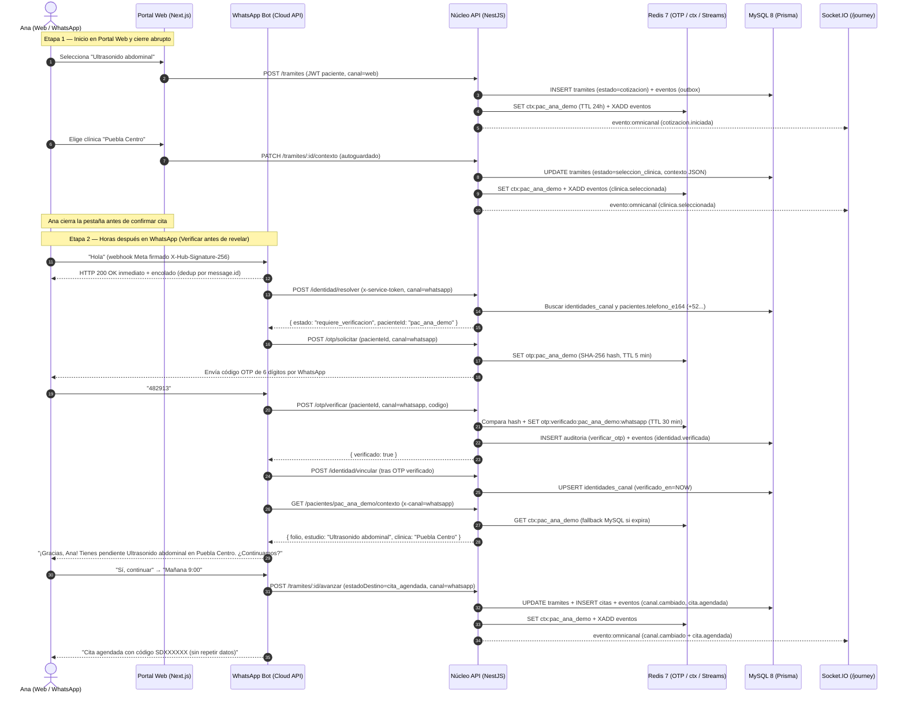
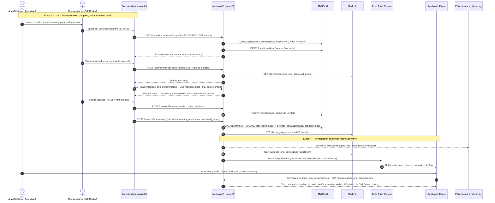
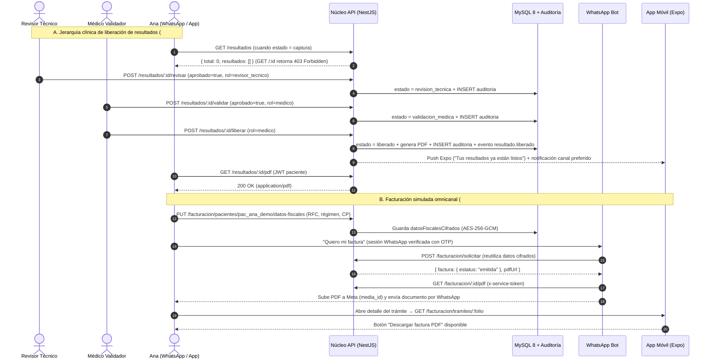
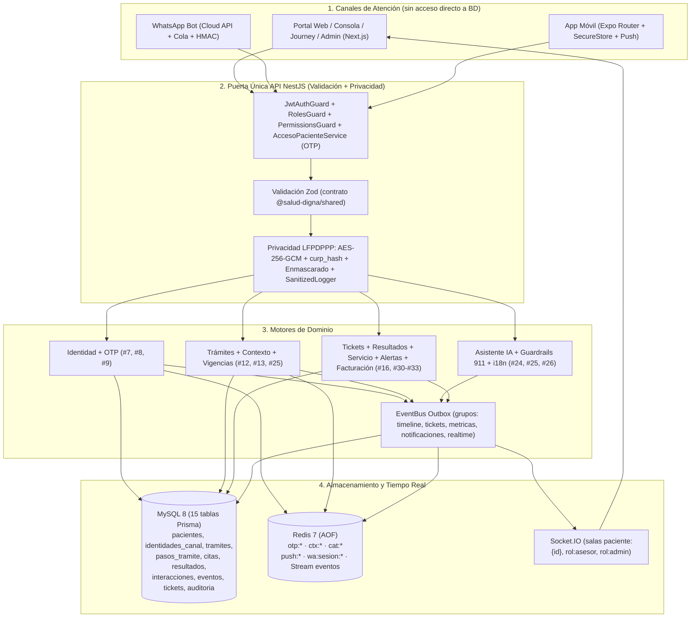

# Diagramas de Secuencia y Flujo de Datos — Salud Digna Omnicanal

> Issue: **41. [DOC] Diagramas de secuencia y flujo de datos** (#41) · Entregable obligatorio.
>
> Todos los diagramas reflejan los endpoints reales de `apps/api`, `apps/whatsapp-bot`, `apps/web` y `apps/mobile`, así como el esquema Prisma de [`apps/api/prisma/schema.prisma`](../apps/api/prisma/schema.prisma) y el catálogo de eventos de [`docs/eventos.md`](eventos.md).

---

## 1. Secuencia: Web → WhatsApp (identidad, OTP y recuperación de contexto)

Fuente Mermaid: [`secuencias/diagramas/01-web-a-whatsapp.mmd`](secuencias/diagramas/01-web-a-whatsapp.mmd).

---

## 2. Secuencia: WhatsApp → Call Center → App Móvil

Fuente Mermaid: [`secuencias/diagramas/02-whatsapp-callcenter-app.mmd`](secuencias/diagramas/02-whatsapp-callcenter-app.mmd).

---

## 3. Secuencia: Jerarquía de resultados clínicos (#30) y Facturación PDF (#33)

Fuente Mermaid: [`secuencias/diagramas/03-resultados-y-facturacion.mmd`](secuencias/diagramas/03-resultados-y-facturacion.mmd).

---

## 4. Flujo de datos y relación con el Modelo ER (#2)

Fuente Mermaid: [`secuencias/diagramas/04-flujo-datos-y-modelo.mmd`](secuencias/diagramas/04-flujo-datos-y-modelo.mmd).

### Diagrama Entidad-Relación exportado (MySQL 8 + Prisma)

Ver documentación completa de las 15 tablas e índices en [`docs/modelo-datos/README.md`](modelo-datos/README.md).

---

## 5. Mapa exacto de datos en tránsito, caché y persistencia

| Etapa | Clave en Redis (TTL) | Tablas MySQL impactadas | Evento Zod emitido |
| --- | --- | --- | --- |
| Resolución y OTP | `otp:{pacienteId}` (5 min, SHA-256) · `otp:verificado:{id}:{canal}` (30 min) | `pacientes`, `identidades_canal`, `auditoria` | `identidad.resuelta`, `identidad.verificada`, `identidad.vinculada` |
| Autoguardado de trámite | `ctx:{pacienteId}` (24 h) | `tramites`, `pasos_tramite`, `eventos` | `cotizacion.iniciada`, `estudio.seleccionado`, `clinica.seleccionada`, `canal.cambiado` |
| Agenda y confirmación | `ctx:{pacienteId}` (24 h) · `push:{pacienteId}` (180 d) | `tramites`, `citas`, `interacciones`, `eventos` | `cita.agendada`, `cita.confirmada` |
| Catálogos cacheados | `cat:estudios:*` · `cat:clinicas:*` (10 min) | `estudios`, `clinicas` | — |
| Sesión de WhatsApp | `wa:sesion:{telefono}` (24 h) | `interacciones` (`referencia_externa` única) | `ticket.creado`, `canal.cambiado` |
| Resultados y auditoría | Stream `eventos` | `resultados`, `eventos`, `auditoria` | `resultado.liberado` |
